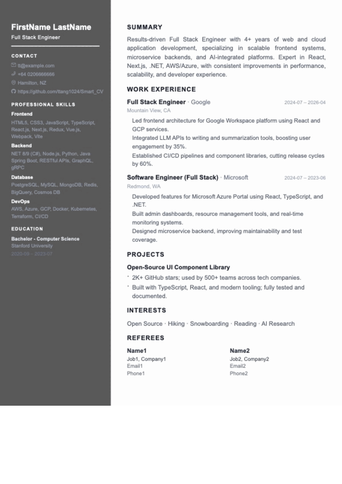

# SmartCV

AI-powered resume builder. Runs entirely in your browser — no account, no cloud storage, no data leaving your device.




## Features

- **AI tools** — job-description optimization with ATS match score, cover letter and follow-up email generation, proofreading, interview prep, and an interactive mock interviewer with voice dictation
- **ATS checker** — instant client-side resume audit, no AI key needed
- **Job versions** — fork your resume per role, track application status, and compare against the original
- **Translation** — translate the whole resume into another language as a new linked copy
- **9 resume styles** — plus a fully configurable Custom style and live theme colour
- **Import / export** — PDF import (incl. LinkedIn exports and scanned PDFs via OCR), pixel-perfect PDF export, client-side DOCX export, and [JSON Resume](https://jsonresume.org) interchange
- **Private share links** — read-only copy compressed into the URL fragment, with QR code
- **Private by default** — resumes, history and job tracking live in IndexedDB on your device; PDFs are read in the browser. The server only renders PDF exports and relays AI calls made with your own key
- **Bring your own AI** — OpenAI, Claude, Gemini, Grok, DeepSeek, Qianwen, Kimi, Doubao, or Wenyanyixin

## Getting Started

**Prerequisites:** Node.js 20+, .NET SDK 10+

```bash
git clone https://github.com/ttang1024/Smart_CV.git && cd Smart_CV
cd SmartCV.API && dotnet run                          # backend → http://localhost:5167
cd SmartCV.Web && npm install && npm run dev          # frontend → http://localhost:3000 (second terminal)
```

Then add an API key for your preferred AI provider in **Settings**. Keys are stored in your browser's localStorage and sent with each AI request through the API's relay, which never stores or logs them.

**Production build** (one .NET process serves the API and the SPA):

```bash
cd SmartCV.Web && npm run build
cd ../SmartCV.API && dotnet publish -c Release -o ./publish
./publish/SmartCV.API
```

## Tech Stack & Architecture

Next.js 16 (static export) + React 19 + TypeScript + Tailwind, with Zustand and IndexedDB for state. Backend is a .NET 10 Minimal API. i18n via i18next (en / es / zh-CN / zh-TW).

```
Browser (Next.js SSG)
  │  IndexedDB — resumes, undo history, job applications, score history
  │  localStorage — settings and API keys
  │  pdf.js / Tesseract — PDF text extraction and OCR, in the browser
  └─ /api ──► .NET 10 Minimal API  (rate-limited, CSP + security headers)
                  ├─ /api/ai/chat        — relays to the chosen AI provider (browsers can't call most provider APIs directly)
                  ├─ /api/pdf/parse-text — rule-based structuring of extracted resume text (used when AI is off)
                  ├─ /api/pdf/generate   — renders resume HTML to PDF in a locked-down Chromium page
                  └─ /api/health
```

The PDF renderer disables JavaScript and blocks every network request except inline `data:` URLs, time-boxes each render and limits concurrent renders.

See [`tech/`](tech/) for detailed module documentation.

## Deployment

Docker container on AWS App Runner (`ap-southeast-2`), built locally and pushed to Amazon ECR; infrastructure is declared in `aws/cloudformation.yml`. Requires Docker and AWS CLI v2 with permissions for ECR, CloudFormation, IAM, and App Runner.

```bash
./deploy.sh [tag]              # full deploy: ECR repo + image + CloudFormation stack
./deploy.sh --app-only [tag]   # new image for an existing stack (also: ./deploy-app.sh)
```

The stack includes an App Runner health check on `/api/health` and autoscaling.

## Contributing

Open an issue before submitting a large PR; small fixes can go straight to a PR. CI (`.github/workflows/ci.yml`) runs lint, typecheck, unit and e2e tests, the API tests and a container build on every PR; run `npm run lint && npm test` in `SmartCV.Web` and `dotnet test` at the root before opening one.

## License

[MIT](LICENSE)
